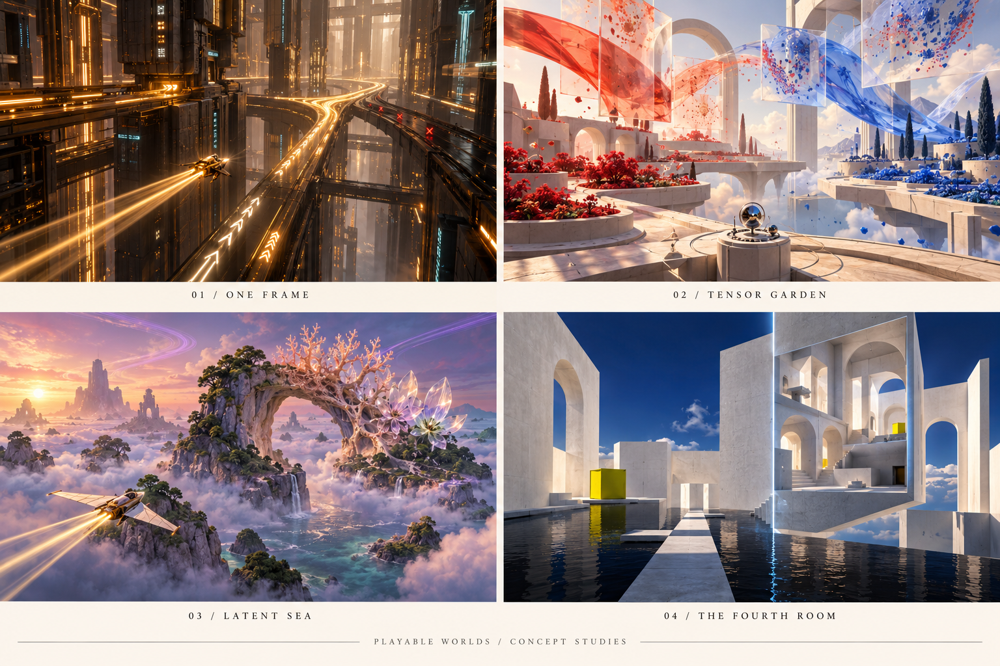

# Playable worlds — four portfolio concepts

Saved 22 October 2026. **Selected for development: One Frame.**

The brief: an actually playable 3D world that lets visitors experience something humans cannot physically experience, while learning a topic through its mechanics. Free movement, goals, discoveries, meaningful consequences, and a strong aesthetic. These are creative technology portfolio projects, discoverable from **Work**, rather than Community tools.

The board is AI-generated art direction, not a screenshot or a performance promise.

## 1. One Frame

**Live an entire adventure inside a screen refresh.**

You are a signal-courier in a GPU: processor towers, copper canyons, and thousands of moving signals. Help the machine complete one frame by collecting memory requests, running a branching convoy, and resolving candidates for the final pixel. Fly, boost, explore side routes, and restore stalled districts. The ending pulls you out to a display: the whole adventure represents one screen refresh.

**Aesthetic:** graphite megastructures, etched copper, amber currents, sparse cyan, atmospheric depth, mechanical sound that grows as work completes.

**Learning:** adjacent memory requests use fetched data more efficiently; divergent branches activate different lanes; depth testing determines the visible surface. The chip architecture and traveller are metaphors, with explicit simplified computational rules.

**Technology:** procedural instanced architecture, WebGPU/TSL signal fields, node materials, local atmosphere, and a continuous flight controller. Responsive quality tiers and a WebGL2 renderer fallback.

**First expedition:** three connected districts, checkpoints, optional discoveries, and a final display reveal. Route `/time-frame`; project article `/one-frame`; discovery from `/work`.

## 2. Tensor Garden

**Teach a living landscape to recognize a pattern.**

Walk through a garden of seeds, sheets, and mathematical ribbons. Red and blue populations are tangled together. Change weights at transformation gates, introduce nonlinear operations, and release another batch. Once the mechanism makes sense, train the small network and see the landscape reorganize. Unseen examples reveal whether the solution generalizes.

**Aesthetic:** warm porcelain, translucent glass, vermilion and cobalt pigment, sunlight, soft architectural shadows, musical classification feedback.

**Learning:** tensors as collections of values, matrix transformations, activations, weights, training, and generalization.

**Technology:** an actual small neural network drives the positions and colors; instanced seeds and shader-deformed surfaces reveal intermediate representations.

**Strength:** especially clear connection between player action and learning, with a manageable initial scope.

## 3. Latent Sea

**Navigate the space between things.**

Pilot a glider through incomplete possibilities: branching stone, glass flowers, coral arches. Recover forms from property clues, preserve one feature while changing another, and chart routes between familiar shapes. Discover convincing intermediate forms.

**Aesthetic:** pearl fog, moss green, lavender currents, gold light, tactile floating islands, atmospheric depth, granular spatial audio.

**Learning:** embeddings, similarity, interpolation, and the limits of low-dimensional projections. The user confirmed that the original “j-space” reference meant AI latent/embedding space.

**Technology:** volumetrics, procedural terrain, and morphing forms tied to a small trained model or sampled decoder output. Shader appearance must not be passed off as a learned relationship. Distances in a 3D projection do not preserve all high-dimensional relationships.

**Strength/challenge:** the most dreamlike art direction; meaningful navigation and faithful model relationships require particular care.

## 4. The Fourth Room

**Discover a direction your body has never had.**

Explore an impossible building, retrieve objects from enclosed rooms, and reconnect passages by moving through a fourth spatial direction. Learn one surprising action at a time. The central revelation is entering a sealed three-dimensional room by going around its boundary in another dimension.

**Aesthetic:** chalk-white architecture, ultramarine sky, black water, one acid-yellow landmark, silence and spatial sound. Changing cross-sections reveal rooms and sculptures.

**Learning:** dimensionality, cross-sections, projection, and the difference between an object changing and observing different slices of it.

**Technology:** four-dimensional coordinates, consistent slicing and collision, procedural geometry or signed-distance-field rendering. A fourth spatial dimension, not time.

**Strength/challenge:** strongest impossible experience; needs carefully designed, legible spatial puzzles.

## Research references

Research checked 22 October 2026. The release list showed Three.js r186; the existing project uses r185.1. Demo particle counts are not a promised game performance budget.

- [Three.js releases](https://github.com/mrdoob/three.js/releases)
- [WebGPURenderer and migration](https://threejs.org/manual/pages/webgpurenderer)
- [Three.js Shading Language](https://github.com/mrdoob/three.js/wiki/Three.js-Shading-Language)
- [Compute particles](https://threejs.org/examples/webgpu_compute_particles.html)
- [Compute fluid particles](https://threejs.org/examples/webgpu_compute_particles_fluid.html)
- [Volumetric clouds](https://threejs.org/examples/webgpu_volume_cloud.html)
- [Procedural terrain](https://threejs.org/examples/webgpu_tsl_procedural_terrain.html)
- [GPU memory coalescing — NVIDIA](https://developer.nvidia.com/blog/unlock-gpu-performance-global-memory-access-in-cuda/)
- [TensorFlow Playground](https://playground.tensorflow.org/)
- [Activation Atlas](https://distill.pub/2019/activation-atlas/)
- [4D Toys](https://4dtoys.com/)
- [Miegakure](https://miegakure.com/)

## Portfolio placement

Recommended flow: **Work → short Sanity project article → Enter experience → `/time-frame`**. The article provides a shareable, searchable explanation of the idea, design, implementation, and learning goals. The game owns its full-screen interface. The article must use a different slug from the game so a Sanity document cannot collide with the dedicated application route.
